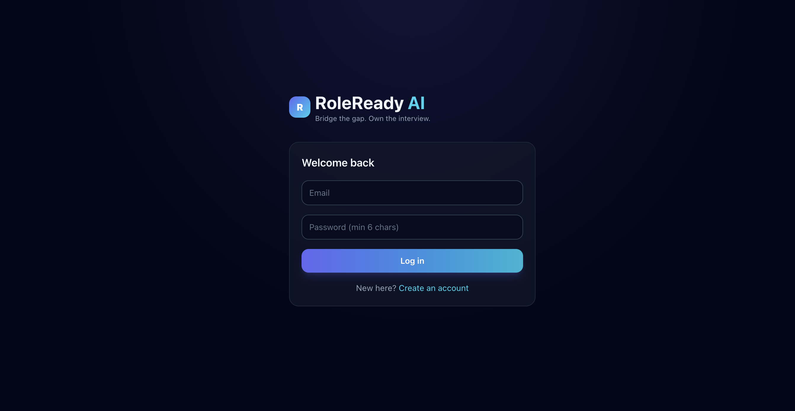
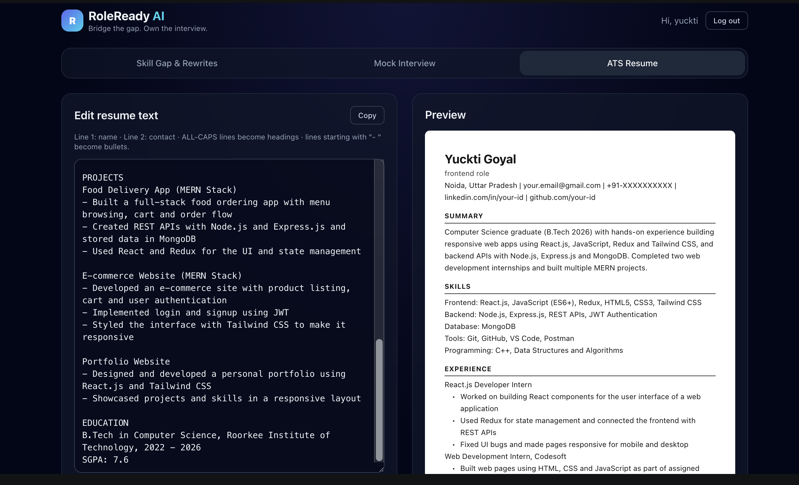
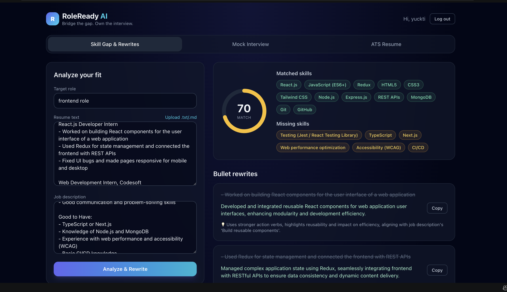
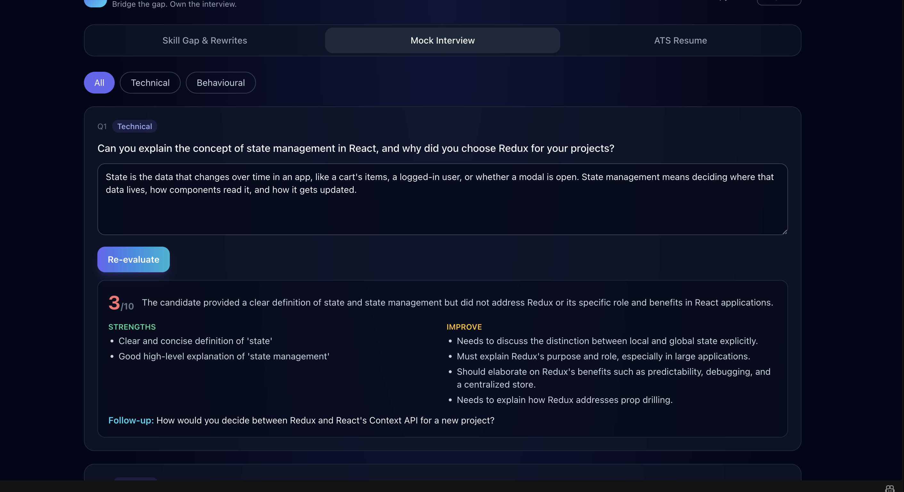

<p align="center">
  
</p>

<h1 align="center">RoleReady AI</h1>

<p align="center"><b>Bridge the gap. Own the interview.</b></p>

<p align="center">
  An AI-powered full-stack web app that compares your resume with a job description, rewrites your bullets, runs a mock interview with feedback, and exports an ATS-friendly PDF resume.
</p>

## 🎥 Demo
- Demo video: _Coming soon_
- Live app:https://frontend-orpin-kappa-92.vercel.app
- Backend API: https://roleready-ai-l9rk.onrender.com

## 📸 Screenshots
| Login & Auth | Workspace & Views |
| :---: | :---: |
|  |  |
|  |  |

## ✨ Features
- **Authentication:** Register and login with JWT, bcrypt password hashing, and protected API routes with clear error messages.
- **Skill gap analysis:** Match score (0–100), matched skills, and missing skills for a target role and job description.
- **Bullet rewrite engine:** Weak resume bullets rewritten into impact-driven ones, each with a reason and a one-click copy button. The AI is instructed not to invent experience or numbers.
- **Mock interview:** Technical and behavioural questions generated from your resume and the job description. Answer each one and get a score (1–10), verdict, strengths, improvements, and a follow-up question.
- **ATS resume PDF:** A clean, single-column, text-based PDF generated on the server with Puppeteer and downloaded as `RoleReady_ATS_Resume.pdf`.
- **Responsive Dark UI:** Clean SaaS interface with loading states, error alerts, and preserved tab state.

## 🛠️ Tech Stack
| Layer | Technology |
| :--- | :--- |
| **Frontend** | React (Vite), Tailwind CSS |
| **Backend** | Node.js, Express |
| **Auth** | JWT, bcryptjs |
| **AI** | Google Gemini (`@google/genai`) |
| **PDF** | Puppeteer (headless Chrome) |

## 🏗️ How It Works
1. The user signs up or logs in, and the backend returns a signed JWT.
2. The frontend sends the token as a `Bearer` header on every protected request.
3. `POST /api/analyze` sends the resume and job description to Gemini and returns validated, structured JSON.
4. The same analysis feeds all three views: skill gap, mock interview, and ATS resume.
5. `POST /api/interview/evaluate` scores each answer with actionable feedback.
6. `POST /api/resume/pdf` renders the resume as HTML and converts it to a real PDF with Puppeteer.

> **Safe AI output handling:** The server strips markdown code fences, extracts the JSON, fixes trailing commas, retries once on failure, and normalizes every field so a messy AI response never crashes the app.

## 📁 Project Structure
```text
roleready-ai/
├── backend/
│   ├── server.js
│   ├── .env.example
│   ├── middleware/auth.js          # JWT verification
│   ├── routes/
│   │   ├── authRoutes.js           # register, login
│   │   ├── prepRoutes.js           # analyze, interview evaluate
│   │   └── resumeRoutes.js         # PDF export
│   └── services/
│       ├── gemini.js               # AI analysis and evaluation
│       ├── json.js                 # safe JSON parsing
│       ├── pdf.js                  # HTML template + Puppeteer
│       └── userStore.js            # simple JSON user storage
├── frontend/
│   ├── .env.example
│   └── src/
│       ├── App.jsx
│       ├── components/             # AuthForm, SkillGap, MockInterview, AtsResume, ui
│       └── services/api.js
├── logo/
│   └── logo-icon.svg
├── screenshot/
│   ├── image.png
│   ├── img.png
│   ├── img2.png
│   └── login.png
├── .gitignore
└── README.md